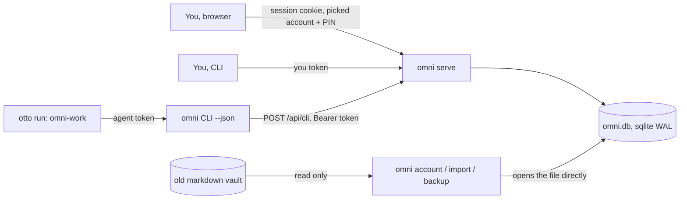

# omnifactum — architecture

Last checked against: `ee9a915` on 2026-11-09

## Purpose and boundaries

A GTD task manager (`omni`) shared by you and your agents: six lists (inbox, next, waiting,
someday, review, done), projects, a tickler and a weekly review, in separate accounts (work,
home). You capture, clarify and decide; agents take `next` tasks tagged `agent` and submit them
to `review`. Only you mark work done.

**Out of scope:** AI inside the app; undo, trash or version history (backups are the way back);
exposure to the internet (plain HTTP, tokens stored as-is); encrypting PINs in transit;
the old markdown vault as live storage (read only by `omni import`).

## Components and data flow



| Component | Where | Does |
|---|---|---|
| CLI | `src/cli.ts`, `src/client.ts` | `serve`, `service`, `backup`, `account`, `import` run locally; every other command is sent to the server |
| Commands | `src/commands/` | Every command, run on the server against the caller's account (`src/commands/run.ts`); defined once for CLI and agents |
| Server | `src/server/server.ts` | Bun.serve: web bundle at "/", sessions, event stream, API; tickler sweep every minute, backup check every hour |
| Request guard | `src/server/hostCheck.ts`, `src/server/pinLimit.ts` | Host/Origin check before any `/api` route; 5 wrong PINs a minute per address, then 429 |
| API | `src/server/api.ts` | JSON routes, each write declaring its roles; intentions re-planned on the row, replacements need `If-Match` |
| Pure core | `src/core/` | Tasks, capture syntax, clarify, recurrence, filters, roles (`src/core/roles.ts`), the agent contract (`src/core/agentsDoc.ts`) |
| Store | `src/db/store.ts` | One account seen by one actor; runs core's planners against the row inside one transaction and records an event |
| Data layer | `src/db/` | Schema and migrations (`src/db/database.ts`), auth, events, projects, tickler, weekly, backups, file modes |
| Vault reader | `src/store/`, `src/local/import.ts` | Scans an old markdown vault for `omni import`; not used at runtime |
| Web app | `src/web/` | React 19, bundled by Bun from `src/web/index.html`; keyboard-first |
| Service | `src/local/service.ts` | launchd agent (macOS), log at logs/serve.log in the data directory |
| Agent skill | `skills/omni-work/SKILL.md` | Find, read, do, submit; copied to ~/.claude/skills and run by otto |
| Installer | `install.sh` | bun install + bun link |

## Where state lives

| State | Where | Survives a crash? | Backed up? |
|---|---|---|---|
| The database (accounts, PINs, tokens, sessions, tasks, logs, projects, ticklers, weekly, events) | omni.db in the data directory (`--dir`, else OMNI_DIR, else ~/.omnifactum; `src/config.ts`) | yes: WAL, busy timeout 5 s | daily VACUUM INTO backups/, integrity-checked, renamed into place, newest 14 daily kept; `omni backup` copies never pruned (`src/db/backup.ts`) |
| The CLI's saved token | token in the data directory (`omni account token … --save`; `src/client.ts`) | n/a | no |
| PIN-guess counts | memory (`src/server/pinLimit.ts`) | no: a restart forgets | no |
| Server log (service only) | logs/serve.log in the data directory | n/a | no |

The server checks for today's backup on start and every hour, so a sleeping Mac still gets one.
Backups sit on the same disk. Migrations are an append-only numbered list in
`src/db/database.ts`, each applied in its own transaction and recorded in PRAGMA user_version;
a failing one rolls back. No down migrations: undoing a bad one means restoring a backup.

## Trust boundaries

Auth is attribution, not security (`src/db/auth.ts`): a token names an account and an actor,
and the server decides by the token's role, never by `--actor` or OMNI_ACTOR (those only relabel
the log for a person's token).

| Actor | Gets in by | Can | Can't |
|---|---|---|---|
| You | `you` token (CLI), or a browser session after picking an account (and its PIN, if set) | everything | issue tokens over HTTP (no endpoint) |
| Agent | `agent:<name>` token for one account | read anything, add, note, tag, submit, move between states other than done | done, rm/DELETE, clarify-discard, `--force`, record the weekly review, write projects or ticklers |
| Shell access as you | `omni account` opens the database directly | issue or revoke any token, set PINs | (outside the model) |
| The network | binds 127.0.0.1 unless `--host`/OMNI_HOST; refuses a non-loopback bind while any account has no PIN; Host must be a loopback name with our port or allowed; foreign-Origin writes get 403 | reach "/" and the account list; open any PIN-less account in a browser (as `you`); the rest needs a token or session | DNS-rebind, or guess PINs faster than 5 a minute |

Secrets on disk: tokens and PINs in the database, a token in the token file. Directories 0700,
database, -wal, -shm, backups and token 0600; `omni serve` tightens looser ones on every start
(`src/db/fileModes.ts`, copied from legenda). The logs/ directory isn't in that set.

## Invariants

| # | Invariant | Enforced by |
|---|---|---|
| I1 | An agent token can't finish, delete or force: exit 2, task unchanged | `tests/e2e/agent-roles.test.ts`: "mv … done, done --force and rm --yes exit 2, and the task is unchanged", "DELETE, done, move to done, clarify-discard and force return the refused envelope" |
| I2 | An agent can't record the weekly review or write ticklers | `tests/e2e/agent-roles.test.ts`: "recording the weekly review and the tickler routes are refused" |
| I3 | Every write route and command declares its roles; undeclared means refused | `tests/e2e/agent-roles.test.ts`: "every non-GET route has a role declaration, and the table names every route", "every command has a role declaration, and the table names every command", "a command name the dispatcher does not know is refused, not run" |
| I4 | A token's actor is `you` or `agent:<name>`, checked when made and when used | `tests/e2e/agent-roles.test.ts`: "createToken refuses an actor that is neither you nor agent:<name>", "an existing token with such an actor is refused, with how to re-issue it" |
| I5 | Submit moves work to review and needs a note | `tests/e2e/review.test.ts`: "submit moves the task to review with the note attached", "submitting without a note is refused, since the note is the whole point" |
| I6 | Concurrent writers lose nothing; a task completes once | `tests/e2e/concurrency.test.ts`: "every tag survives, none is lost — agents at a shell and a person in a browser", "exactly one succeeds and the rest say so clearly" |
| I7 | A replacement from a stale copy is refused with the current task (409) | `tests/e2e/concurrency.test.ts`: "is refused with the current task, rather than overwriting what an agent did"; `tests/e2e/contract.test.ts`: "a stale PATCH really is refused with 409 and the current task, as it says" |
| I8 | Accounts never see each other's tasks | `tests/db/store.test.ts`: "accounts never see each other's tasks" |
| I9 | Every committed change is an event naming its actor | `tests/db/store.test.ts`: "every committed change is announced with who made it" |
| I10 | With --json, success and failure are one envelope on stdout; exit codes 0–4 | `tests/e2e/contract.test.ts`: "match the ones the app uses", "a failure really is an envelope on stdout with stderr empty, as claimed"; `tests/e2e/concurrency.test.ts`: "a write reports busy as JSON on stdout, with nothing on stderr" |
| I11 | `omni agents` and /api/agents serve the same contract, and its commands run | `tests/e2e/contract.test.ts`: "omni agents prints it, and the server serves the same text", "the ones in the command table run without erroring" |
| I12 | A foreign Host, or a write with a foreign Origin, gets 403 | `tests/e2e/r2-host-origin.test.ts`: "Host: evil.example is refused with 403, naming the host and how to allow it", "a POST with a foreign Origin is refused with 403 and changes nothing" |
| I13 | Binds 127.0.0.1 by default; won't bind wider while an account has no PIN | `tests/e2e/r2-serve.test.ts`: "with no host flag or env, omni serve listens on 127.0.0.1 only", "omni serve --host 0.0.0.0 with a PIN-less account exits non-zero naming that account" |
| I14 | A sixth wrong PIN in a minute from one address gets 429 | `tests/e2e/r2-host-origin.test.ts`: "a sixth wrong PIN inside a minute from one address is refused with 429" |
| I15 | Data files are private, and serve tightens looser ones | `tests/e2e/r2-serve.test.ts`: "a new data directory is created 0700 with the db, -wal, -shm, token and backups 0600", "after start on a loose data dir, every private file and directory is tightened" |
| I16 | One good backup a day, 14 kept, a failed one leaves nothing | `tests/db/backup.test.ts`: "happens once a day, however often the server checks", "keeps only the most recent fortnight, plus any taken on demand", "a failed backup leaves nothing that looks like one" |
| I17 | A recurring item adds nothing while its last task is still open | `tests/db/recurring.test.ts`: "while the last one is still open, a firing adds nothing but the schedule moves on" |
| I18 | Tokens are issued only on the server machine, never over HTTP | **unenforced:** true by absence of an endpoint; no test asserts it |
| I19 | Tests never touch the real data directory | **unenforced:** the preload `tests/setup.ts` points OMNI_DIR at a temp dir; no test asserts it |
| I20 | Migrations are append-only; a shipped one is never edited | **unenforced:** a comment in `src/db/database.ts`; candidate for a schema guard test |
| I21 | `src/core/` is pure (no fs, db, clock, randomness, React) | **unenforced:** a rule in `README.md`; candidate for an import check |
| I22 | Every omni command the skill uses exists | **unenforced:** no test reads `skills/omni-work/SKILL.md` (legenda has one) |
| I23 | No AI in the app | **unenforced:** no model SDK in `package.json` today; nothing stops one being added |

## Decisions

There is no PLAN.md or DESIGN.md: `README.md` is the design record. Dates are commit dates.

- 2026-09-12 · Tasks as markdown files, read by scanning the directory · plain text an agent can edit · 2776950
- 2026-09-23 · Web app and one sqlite file with accounts replace the TUI and the files; `omni import` brings a vault over · one writer (the server) makes concurrent edits safe · c167232
- 2026-09-23 · Daily backups checked hourly rather than at a fixed time · a sleeping laptop misses 3am · a51d235
- 2026-09-24 · Tickler items, one-off and recurring · `next` stays literal: things arrive on their day · a6b95d9
- 2026-10-24 · Deny-by-default roles on every route and command (R1) · an agent must never finish or delete work · 2205993, f64a06b
- 2026-10-24 · Bind 127.0.0.1, Host/Origin check, PIN limit, private data files (R2) · LAN and DNS-rebinding exposure; copied from legenda · 6766fd8, ccd6c58, 1b4c355, acf28ae

## Family

Follows legenda's map except (shared design: `~/workspace/architect/FAMILY.md`):

- The CLI is `omni`; commands run on the server through one route (POST /api/cli) rather than
  one endpoint each.
- Agents submit to a `review` list with a note; only you mark done (legenda's agent suggests).
- Accounts: one database holds several separate sets of lists, each token bound to one.
- The browser signs in by picking an account and its PIN, not by trading a token.
- A `store` layer (`src/db/store.ts`) runs core's planners against the live row; replacements
  carry `If-Match`.
- The server sweeps the tickler (deferrals, recurring items) every minute; no web polling.
- No PLAN.md: the README is the design record. The skill has no check script.

## How to verify a change

Rung 1 on the verifiability ladder (`~/workspace/architect/VISION.md`), re-checked: unit and e2e
tests run with one command and the red/green workflow (new tests against the base commit in a
throwaway worktree) works. Part of rung 2: `tests/helpers/cli.ts` (`omniSpawn`) runs the real
CLI against a real server on a temporary database, but only inside the suite; nothing drives the
web app in a browser. No evidence script (rung 3).

```bash
bun install --frozen-lockfile
bun run test            # typecheck + the whole suite
```

## Unverified

- The user's running instance: bind, allowed hosts, PINs, which tokens exist, and whether the
  omni-work otto run is set up as the README describes.
- The omni-work skill in a real otto run (nothing tests it).
- The launchd service on a real machine (`tests/unit/service.test.ts` checks the plist and calls).
- That a failed migration leaves the database usable (no test makes one fail).
- `omni import` against a real old vault (`tests/store/scan.test.ts` covers the scanner only).
- The web app's screens: no browser test.
